# System Architecture Specification

## Overview
The Course Demand Forecasting and Faculty Allocation system is an end-to-end synthetic data engineering pipeline. It simulates the full operational lifecycle of university resource planning: curriculum modeling, student course intent, time-series demand forecasting, section sizing, constraint-based faculty assignment, event auditing, rule-based anomaly detection, and evaluation against isolated ground truth.

```mermaid
flowchart TD
    subgraph Master["1. Master Data Layer"]
        PRG["Programs"]
        CRS["Courses"]
        PRQ["Prerequisites (DAG)"]
        FAC["Faculty & Skills"]
        ROM["Classrooms"]
    end

    subgraph Historical["2. Historical & Intent Layer"]
        STP["Student Plans"]
        TRA["Completed Courses (Transcripts)"]
        REG["Registration Interest (3 Terms)"]
    end

    subgraph Forecast["3. Forecast Engine"]
        WMA["Weighted Moving Average (0.5, 0.3, 0.2)"]
        DFC["Demand Forecast (Bounds & Windows)"]
    end

    subgraph Allocation["4. Constraint Allocation Engine"]
        SEC["Section Sizing & Best-Fit Rooms"]
        WLA["Faculty Matching (Proficiency, Load, Leave)"]
        EVT["Section & Assignment Event Logs"]
        UMD["Unmet Demand Reconciliation"]
        DCL["Decision Logs (Inputs Snapshot)"]
    end

    subgraph EdgeCases["5. Isolated Anomaly Layer"]
        GT["Isolated Ground Truth (data/ground_truth/)"]
        ANO["Controlled Injections"]
    end

    subgraph Validation["6. Validation & Verification"]
        RULE["Rule-Based Detection"]
        EVAL["Precision / Recall Evaluation"]
        TEST["Reproducibility & Unit Tests"]
    end

    Master --> Historical
    Historical --> Forecast
    Forecast --> Allocation
    Allocation --> EdgeCases
    EdgeCases --> Validation
```

## Architectural Tenets

### 1. Deterministic Reproducibility
* **Master Seed:** All pseudo-random generation stems from master seed `20261022`.
* **Isolated Sub-Seeds:** Independent components derive independent sub-generators via fixed offsets (`seed + 100`, `seed + 200`, etc.), eliminating cross-module interference.
* **Zero Clock Dependence:** The pipeline never calls `datetime.now()` or unseeded randomness. All dates derive from fixed calendar dates (`AS_OF_DATE = 2026-10-22`).
* **Deterministic Serialization:** All datasets are sorted by primary key before export to ensure bit-for-bit SHA-256 reproducibility across repeated runs.

### 2. Multi-Database Portability
* **Default Reviewer Engine (SQLite):** Python's standard library (`sqlite3`) handles database creation and execution natively with zero external dependencies.
* **Enterprise Postgres Parity:** `database/schema.sql` is authored using standard portable types (`INTEGER`, `TEXT`, `REAL`, `DATE`, `CHECK`, `PRIMARY KEY`, `FOREIGN KEY`), compatible with SQLite, PostgreSQL 16, and cloud Supabase.
* **Containerization:** `database/docker-compose.yml` provides a ready-to-run PostgreSQL 16 service for optional multi-engine validation.

### 3. Strict Anomaly Isolation
* Injected negative scenarios (`faculty_outside_skill`, `workload_exceeded`, `section_capacity_too_low`, `prerequisite_violation`, `duplicate_section_assignment`) are documented exclusively in `data/ground_truth/ground_truth.csv` and `.json`.
* **Zero Feature Leakage:** Production tables (`data/output/`) contain no ground truth columns (`issue_type`, `injected_flag`). The validation engine detects anomalies using pure domain business rules, allowing an objective measure of precision and recall.

### 4. Explainability & Auditing
* Every allocation or rejection generates a structured `decision_log` entry recording the decision outcome, standard reason code, plain-English explanation, and a JSON snapshot of the candidate evaluation criteria.
* Explicit event tables (`section_event`, `assignment_event`) preserve full lifecycle auditability without destructive overwrites.

