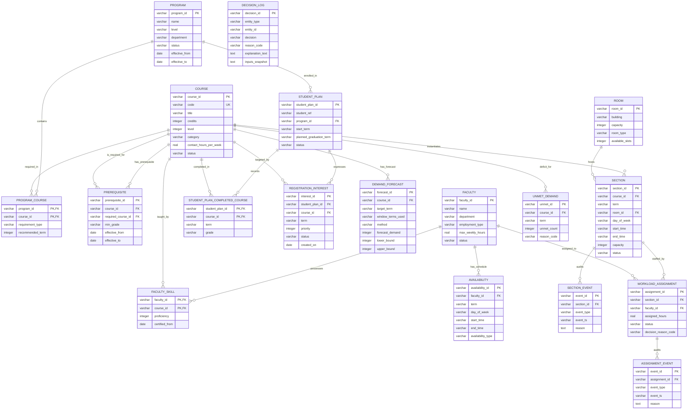

# Entity-Relationship (ER) Diagram

The data model uses 18 normalized tables spanning Master Data, Student Planning, Demand Forecasting, Classroom/Faculty Allocation, Audit Trails, and Explainability.

